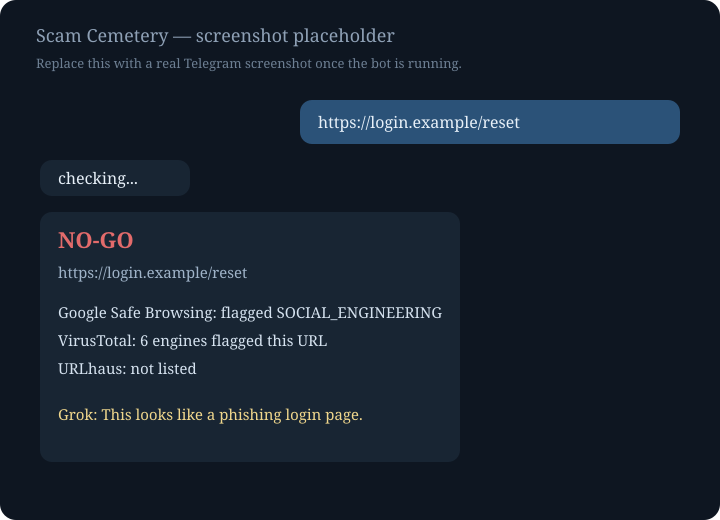

# Scam Cemetery

Paste a link, an email address, or a phone number in a private Telegram chat. The bot replies `checking...`, then a verdict: **GO**, **CAUTION**, or **NO-GO**, with one line from each check and a plain-English sentence from the judge.

A personal checker for its owner. It is not a public scanning service. Email addresses and phone numbers are stored redacted, not in full.



A real reply looks like this:

```
NO-GO
https://login.example/reset

Google Safe Browsing: flagged SOCIAL_ENGINEERING
VirusTotal: 6 engines flagged this URL
URLhaus: not listed

Grok: This looks like a phishing login page.
```

An email reply names the address in redacted form. A PayPal lookalike is NO-GO:

```
NO-GO
b***@paypa1.com

Email: valid syntax, domain paypa1.com
Brand lookalike: paypa1.com resembles PayPal (paypal.com) by homoglyph

Rules: Brand lookalike flagged this email.
```

## Setup

You need Python 3.12 if you run it directly, or Docker if you run the compose file. The intended host is an Ubuntu 24.04 VPS. The container image brings its own Python.

### 1. Create the bot and learn your user id

1. Message [@BotFather](https://t.me/BotFather), run `/newbot`, and copy the token into `TELEGRAM_BOT_TOKEN`.
2. Message [@userinfobot](https://t.me/userinfobot) and copy your numeric id into `ALLOWED_TELEGRAM_USER_IDS`.

The allowlist is the lock. Anyone else who finds the bot gets no reply at all, including to `/start`.

### 2. API keys

Leave a key blank to skip that source. The reply says which source was skipped.

| Variable | Where it comes from |
| --- | --- |
| `GOOGLE_SAFE_BROWSING_KEY` | Google Cloud, Safe Browsing API enabled, then an API key |
| `VIRUSTOTAL_API_KEY` | A VirusTotal account's API key |
| `URLHAUS_AUTH_KEY` | Free key from [auth.abuse.ch](https://auth.abuse.ch/) |
| `XAI_API_KEY` | An xAI API key. Blank means the rules judge runs every check |
| `NUMVERIFY_API_KEY` | Optional. A [Numverify](https://numverify.com/) key for a live carrier and line type. Blank skips it. The number is sent only when the key is set, and it is not stored |

Optional: `XAI_MODEL` (default `grok-4.7`), `SOURCE_TIMEOUT_SECONDS` (default `8`), `XAI_TIMEOUT_SECONDS` (default `20`), `DATABASE_PATH` (default `data/checks.db`), `DEFAULT_PHONE_REGION` (default `US`, used when a phone number has no country code).

### 3. Configure

```bash
cp .env.example .env
# fill in .env. Do not commit it.
```

### Run with Docker

From the repo directory, on the VPS:

```bash
docker compose up -d --build
docker compose logs -f bot
```

The bot uses Telegram long polling. Nothing listens for inbound connections, and the compose file publishes no ports. Checks are stored in the `bot-data` volume at `/app/data/checks.db`. Copy the database out with:

```bash
docker compose cp bot:/app/data/checks.db ./checks.db
```

Stop it with `docker compose down`. The volume keeps the database.

### Run locally

```bash
python3.12 -m venv .venv
source .venv/bin/activate
pip install -e ".[dev]"
set -a && source .env && set +a
python -m scam_cemetery
```

## How a check works

1. The message is refanged (`hxxp`, `[.]`, `(.)`, `[dot]`, `[:]`, and `[at]` for email). Links are taken first, then email addresses, then phone numbers. A bare domain is fine. Up to three items per message are checked.
2. For a link, Google Safe Browsing v4, VirusTotal v3, and URLhaus run **in parallel**. For an email, the same three run against `https://the-domain/`, plus syntax, MX/SPF/DMARC, RDAP domain age, a vendored disposable-domain list, and a small brand lookalike list. For a phone number, libphonenumber runs offline (validity, region, line type). Numverify runs only when its key is set. Each check has a timeout. One slow or failed source cannot block the reply.
3. The results go to the judge. Grok (xAI's OpenAI-compatible API at `https://api.x.ai/v1`) returns the verdict and one sentence when it agrees with the rules table. If it disagrees, or xAI is down, the rules judge answers. The sentence says "this URL", "this email", or "this phone number".
4. If VirusTotal has never scanned the link, or the email's domain, the bot submits that URL and sends another message when the scan finishes, or after about 60 seconds. It does not submit the mailbox. VirusTotal calls stay at or under 4 per minute, shared by links and emails.
5. The check is written to SQLite. A link is stored as itself. An email or phone number is stored as a SHA-256 of the canonical form (lowercased email, or E.164) and a redacted display form such as `j***@paypal.com` or `+1******2671`. The raw value is not stored and is not written to the log.

`/archive` marks your latest check so the 90-day cleanup will not delete it. `/start` explains the bot. Both stay silent for anyone who is not on the allowlist.

## How verdicts are chosen

The rules judge, which also runs when Grok is unavailable:

| Situation | Verdict |
| --- | --- |
| Any source reports malicious | **NO-GO** |
| Any source is suspicious, and nothing is malicious | **CAUTION** |
| At least one source is clean, and none are malicious or suspicious | **GO** |
| No source came back clean (skipped, unscanned, timed out, or failed) | **CAUTION** |
| Disposable email domain | **CAUTION** at best. Never **GO** |
| Domain resembles a watched brand (PayPal, Apple, Microsoft, Amazon, Google, big banks, shippers) | **NO-GO** |

A skipped, unscanned, or failed source does not pull a clean result down to CAUTION. Suspicion does: that is a real disagreement, not a missing answer. A disposable domain is suspicious. A brand lookalike is malicious.

What each source means:

- **Google Safe Browsing.** A hit on the malware, social engineering, unwanted software, or potentially harmful application list is malicious. An empty response is clean.
- **VirusTotal.** One or more engines marking the URL malicious is a hit. Suspicious-only is caution. A URL it has never scanned does not change the first verdict when another source is clean. The bot then submits it for analysis and follows up.
- **URLhaus.** A listed URL is malicious, including one marked offline. `no_results` is clean, because URLhaus only lists malware URLs.
- **Email syntax.** A parsed address is clean. The reply names the domain, not the mailbox.
- **Mail DNS.** No MX record is suspicious, including a null MX (`0 .`), which means the domain does not accept mail. SPF and DMARC are reported; missing either one does not change the verdict by itself.
- **Domain age.** RDAP via the IANA bootstrap, no key. Registered under 30 days ago is suspicious. A missing date does not, by itself, block GO when another source is clean.
- **Disposable domain.** A snapshot of the normal-mode list from [disposable/disposable](https://github.com/disposable/disposable), vendored in the package. Ordinary freemail is not on that list. A hit is suspicious.
- **Brand lookalike.** Homoglyphs, one-character typos of longer names, bait words (`paypal-secure`), a different top-level domain, and a brand domain embedded in a longer host. The real domain and its own subdomains are clean.
- **Phone.** Offline prefix data: valid or not, country, and line type. Premium-rate, shared-cost, VoIP, and invalid numbers are suspicious. This is not a live carrier lookup.
- **Numverify.** Live carrier and line type, only with `NUMVERIFY_API_KEY`. Blank skips the line.

Grok writes the sentence when it picks the same verdict as this table. If it disagrees, the rules verdict is the one that is sent.

## Development

```bash
pip install -e ".[dev]"
ruff check .
ruff format --check .
pytest
```

Tests mock every network call. `tests/fixtures/urls.json` holds known-good sites and Google's published Safe Browsing test URLs, with illustrative source payloads (not live captures).

GitHub Actions runs ruff and pytest on every push and pull request.

### Layout

```
scam_cemetery/
  url_extract.py     messy text -> http(s) URLs
  subjects.py        links, then emails, then phones
  sources/           threat intel, email checks, phone checks
  judges/            Judge interface, Grok, rules fallback
  pipeline.py        parallel lookups, then the judge chain
  storage.py         SQLite, 90-day cleanup, archive flag
  bot.py             allowlist, "checking...", the reply
```

To add a model later, implement `Judge` in `scam_cemetery/judges/base.py` and insert it in the list in `build_pipeline`, ahead of `RulesJudge`. An open-source model first, then OpenAI, is the intended order. Neither is built yet.

## Roadmap

- More sources.
- Model fallbacks: a local open-source model, then OpenAI, behind the same judge interface.
- Deeper escalation checks against Exploit-DB and CVE data when a link is not just "known bad" but points at a specific vulnerability.
- A small "mini SOC" direction: keeping the archive, noticing repeats, and summarizing what the owner has been sent.

Choices and the reasons for them are in [DECISIONS.md](DECISIONS.md).
